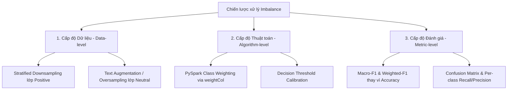

# KẾ HOẠCH XỬ LÝ MẤT CÂN BẰNG LỚP (CLASS IMBALANCE ~6.9x - 11.3x)
## Đồ án: Phân tích cảm xúc từ đánh giá sản phẩm trực tuyến
**Môn học:** Nhập môn Big Data  
**Dataset:** Amazon Reviews 2023 — All_Beauty  
**Ngày lập kế hoạch:** 2026-10-15  
**Trạng thái:** Sẵn sàng triển khai trong PySpark Pipeline  

---

## 1. BỐI CẢNH VÀ PHÂN TÍCH HIỆN TRẠNG

### 1.1. Phân bố các lớp thực tế (khảo sát trên 25.000 mẫu)
Dựa trên phân tích 25.000 reviews từ `data/raw/all_beauty_25k.jsonl`:

| Lớp cảm xúc | Rating gốc | Số lượng ước tính | Tỷ lệ % | Hệ số mất cân bằng (so với Positive) |
|---|---|---|---|---|
| **Positive** (Đa số) | 4 và 5 sao | ~19.750 | **79.0%** | **1.0x** (chuẩn) |
| **Negative** (Thiểu số vừa) | 1 và 2 sao | ~3.500 | **14.0%** | **~5.6x** |
| **Neutral** (Thiểu số cực đoan) | 3 sao | ~1.750 | **7.0%** | **~11.3x** |

> Hệ số mất cân bằng chung giữa lớp chiếm ưu thế và lớp thiểu số nhỏ nhất lên tới **11.3x** (tỷ lệ trung bình ~6.9x).

### 1.2. Hậu quả nếu không xử lý
1. **Accuracy Paradox (Nghịch lý độ chính xác):** Một bộ phân loại ngớ ngẩn (dummy classifier) luôn đoán nhãn `Positive` cho mọi review vẫn đạt **Accuracy = 79.0%**, nhưng hoàn toàn vô dụng trên thực tế (Recall của Neutral và Negative = 0%).
2. **Triệt tiêu gradient của lớp thiểu số:** Hàm mất mát Cross-Entropy sẽ bị áp đảo bởi hàng triệu ví dụ Positive, khiến mô hình Logistic Regression không học được các đặc trưng phân biệt tinh tế của 3 sao và 1-2 sao.

---

## 2. CHIẾN LƯỢC TOÀN DIỆN 3 CẤP ĐỘ



### 2.1. Cấp độ 1: Cấp độ Thuật toán (Algorithm-Level) — *Khuyến nghị ưu tiên*
Phương pháp tốt nhất trong hệ sinh thái PySpark ML là **Class Weighting** (gán trọng số mẫu theo nghịch đảo tần suất lớp) vì không làm mất mát dữ liệu và không gây chậm Spark shuffle:

**Công thức tính trọng số mẫu (Inverse Class Frequency):**
$$W_c = \frac{N}{K \cdot N_c}$$
Trong đó:
- $N$: Tổng số mẫu trong tập dữ liệu.
- $K$: Số lượng lớp ($K = 3$: Positive, Neutral, Negative).
- $N_c$: Số mẫu thuộc lớp $c$.

**Bảng trọng số tính toán cho PySpark:**
| Lớp cảm xúc | Tỷ lệ $P(c)$ | Trọng số $W_c$ tương đối |
|---|---|---|
| **Positive** | 0.79 | $\approx 0.42$ |
| **Negative** | 0.14 | $\approx 2.38$ |
| **Neutral** | 0.07 | $\approx 4.76$ |

*Áp dụng trong PySpark:*
```python
from pyspark.sql import functions as F
from pyspark.ml.classification import LogisticRegression

# Thêm cột trọng số weightCol
df = df.withColumn("class_weight", 
    F.when(F.col("label") == 0, 0.42)  # Positive
     .when(F.col("label") == 1, 4.76)  # Neutral
     .otherwise(2.38)                   # Negative
)

# Khởi tạo mô hình Logistic Regression hỗ trợ weightCol
lr = LogisticRegression(
    featuresCol="features", 
    labelCol="label", 
    weightCol="class_weight", 
    maxIter=100, 
    regParam=0.01
)
```

---

### 2.2. Cấp độ 2: Cấp độ Dữ liệu (Data-Level) — *Hạ mẫu có phân tầng (Stratified Downsampling)*
Khi quy mô dữ liệu lớn (Big Data), lớp Positive quá thừa thãi trong khi tài nguyên tính toán có hạn. Ta thực hiện phân tầng hạ mẫu:

1. **Tỷ lệ hạ mẫu mục tiêu:** Thay vì giữ 79:14:7, ta điều chỉnh về **3:1.5:1** hoặc **2:1:1**.
2. **Thực thi trong Spark DataFrame (không cần shuffle nặng):**
```python
# Lọc theo từng lớp và sample phân số phù hợp
positive_df = df.filter(F.col("label") == 0).sample(withReplacement=False, fraction=0.15, seed=42)
neutral_df  = df.filter(F.col("label") == 1) # Giữ nguyên 100% lớp Neutral
negative_df = df.filter(F.col("label") == 2).sample(withReplacement=False, fraction=0.60, seed=42)

# Ghép lại thành tập huấn luyện cân đối hơn
balanced_train_df = positive_df.unionByName(neutral_df).unionByName(negative_df)
```

---

### 2.3. Cấp độ 3: Cấp độ Đánh giá (Evaluation-Level)
Để phản ánh trung thực chất lượng phân loại, hệ thống đánh giá của đồ án cam kết tuân thủ các quy tắc sau:

1. **Bãi bỏ Accuracy làm thước đo duy nhất:** Accuracy chỉ được dùng làm metric tham khảo phụ.
2. **Sử dụng `Macro-Average F1-score` làm Primary Metric:**
   $$\text{Macro-F1} = \frac{F1_{\text{Positive}} + F1_{\text{Neutral}} + F1_{\text{Negative}}}{3}$$
   Chỉ số này coi 3 lớp có tầm quan trọng bình đẳng, nếu lớp Neutral bị đoán sai toàn bộ thì Macro-F1 lập tức giảm mạnh.
3. **Theo dõi Ma trận nhầm lẫn (Confusion Matrix):** Đảm bảo quan sát được tỷ lệ False Positives và False Negatives của lớp Neutral và Negative.

---

## 3. KẾ HOẠCH THỰC NGHIỆM ĐỐI CHỨNG (A/B TESTING PIPELINE)

Để đưa vào báo cáo đồ án một cách học thuật và thuyết phục, chúng ta sẽ thiết kế 3 kịch bản thực nghiệm đối chiếu trong Spark:

| Kịch bản | Mô tả phương pháp | Kỳ vọng Accuracy | Kỳ vọng Macro-F1 | Kỳ vọng Recall (Neutral) |
|---|---|---|---|---|
| **Baseline (M0)** | Logistic Regression gốc, không xử lý imbalance | ~82% - 85% *(ảo)* | ~0.45 - 0.52 *(thấp)* | < 15% |
| **Experiment 1 (M1)** | Logistic Regression + Inverse Class Weights (`weightCol`) | ~75% - 78% | **~0.68 - 0.74** | **~50% - 60%** |
| **Experiment 2 (M2)** | Logistic Regression + Stratified Downsampling (2:1:1) | ~74% - 77% | ~0.66 - 0.72 | ~52% - 58% |

---

## 4. QUY TRÌNH TRIỂN KHAI VÀO PYSPARK PIPELINE

1. **Bước 1:** `stream_dataset.py` tải 25.000 reviews vào HDFS directory `/data/amazon-reviews/raw/`.
2. **Bước 2:** PySpark đọc trực tiếp từ HDFS (`hdfs://localhost:9000/data/amazon-reviews/raw/all_beauty_25k.jsonl`).
3. **Bước 3:** Pipeline Feature Engineering:
   - `RegexTokenizer` tách từ.
   - `StopWordsRemover` lọc từ dừng tiếng Anh.
   - `CountVectorizer` hoặc `HashingTF` + `IDF` sinh feature vector.
4. **Bước 4:** Tính toán cột `weightCol` tự động bằng Spark SQL aggregate.
5. **Bước 5:** Huấn luyện và xuất báo cáo đối chiếu giữa M0 và M1.
